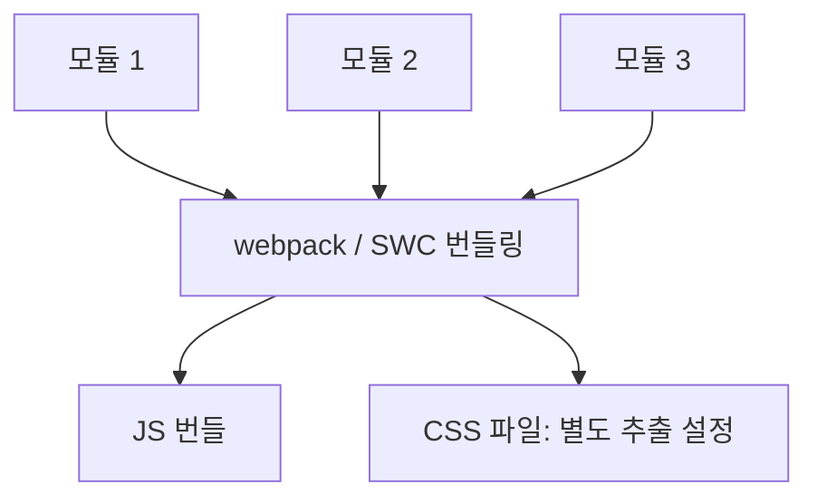

# 2026-10-07 학습 내용

## 1. 오늘 배운 내용과 목표

- 오늘 배운 주제: Next.js 개발환경 & React / TSX 기초
- 오늘의 목표: React와 Next.js의 렌더링 동작 원리(CSR/SSR) 이해, TSX 작성 규칙 및 반환 타입 숙지
- 수업을 듣기 전 알고 있던 내용: React가 프론트엔드에서 핵심적이고 중요하다는 것 정도만 알고 있음

---

## 2. 개념과 용어 정리

### 1) React.js와 Next.js 비교
- React.js (라이브러리)
  - CSR (Client-Side Rendering): 빌드 시 생성된 `index.html`(`<div id="root"></div>`)과 JS 번들을 브라우저가 다운로드받은 뒤, 클라이언트 브라우저에서 동적으로 화면을 렌더링.
  - 장점: 초기 로딩 후 페이지 전환이 부드럽고 빠름 (SPA).
- Next.js (프레임워크)
  - React.js 기반의 풀스택 웹 프레임워크.
  - SSR (Server-Side Rendering):
    - Prerender (사전 렌더링): 서버에서 먼저 번역하여 내용이 채워진 HTML을 생성해 브라우저에 전송 (초기 로딩 속도 향상, SEO 최적화).
    - Hydration (수화): 서버에서 전달받은 정적 HTML에 React 자바스크립트 엔진과 이벤트 핸들러를 연결해 동적 페이지로 활성화.
  - SWC 컴파일러: Rust 언어로 개발된 초고속 컴파일러. Babel/Webpack 대비 번들링 및 트랜스파일 속도가 대폭 향상됨.

### 2) 모듈 번들링과 패키지 관리
- 모듈 번들링 흐름:

- package.json (프로젝트 명세서):
  - dependencies: 실제 프로덕션 배포 시 포함되는 의존성 (`npm i 패키지명`)
  - devDependencies: 개발 환경에서만 필요한 의존성 (`npm i -D 패키지명`)
  - scripts: `npm run <명령어>` 형태로 실행할 프로젝트 명령어 모음
  - npm i: `package.json` 명세를 바탕으로 필요한 의존성을 일괄 설치
- 모듈 시스템 (ES Modules):
  - export (내보내기): 모듈을 다른 파일에서 공유할 수 있도록 노출.
    - export default ...: 파일당 단 하나만 가능 (import 시 중괄호 없이 원하는 이름으로 호출).
    - export { ... }: 여러 개 내보내기 가능 (import 시 중괄호 `{ }` 필수).
  - import (가져오기): `import 모듈명 from '모듈경로'`

---

### 3) JSX / TSX 핵심 문법 및 작성 규칙
- 개념:
  - JSX (JavaScript XML): HTML과 유사한 마크업 문법을 사용하여 React 컴포넌트 화면 구조를 표현.
  - TSX (TypeScript XML): TypeScript 문법과 결합하여 정적 타입 검사를 지원하는 JSX.
  - 컴포넌트 결합: 자바스크립트 데이터 로직과 HTML 형태의 UI 구조를 하나의 파일에서 직관적으로 통합 관리.
  - 웹 브라우저는 JSX/TSX를 직접 해석하지 못하므로, SWC 컴파일러가 순수 자바스크립트 함수 호출 코드로 변환함.

#### ① 단일 루트 요소 (Single Root Node)
- 자바스크립트 반환 원리: 함수는 한 번에 단 하나의 객체만 반환할 수 있으므로, 최상위 태그는 반드시 하나여야 함.
- 가상 DOM 비교 효율성: React가 가상 DOM을 빠르게 비교(Diffing)하려면 뿌리가 하나인 단일 트리 구조여야 검색/연산 속도가 최적화됨.
- `<Fragment>` 및 빈 태그 (`<>...</>`)의 역할:
  - DOM 오염 방지: 여러 요소를 감싸기 위해 불필요한 `<div>`를 남발하지 않고, 실제 브라우저 DOM에는 태그를 남기지 않으면서 리액트 노드만 깔끔하게 묶어줌.
  - CSS 레이아웃 유지: 불필요한 래퍼 태그로 인해 Flexbox나 Grid의 부모-자식 레이아웃 관계가 깨지는 문제 방지.

#### ② 모든 태그의 닫힘 보장 (Self-Closing Tag)
- HTML과의 차이: HTML에서는 `<br>`, ``, `<input>`, `<hr>` 같은 단일 태그 작성 시 닫는 기호를 생략해도 브라우저가 유연하게 처리함.
- JSX/TSX의 엄격한 규칙: XML 문법을 기반으로 하므로 모든 태그의 닫힘 기호가 필수.
- 셀프 클로징 표기법 (`/>`): 내용물이 없는 단일 태그는 끝에 슬래시를 붙여 닫아야 함 (``, `<br />`, `<input />`). 누락 시 구문 에러(`SyntaxError`) 발생.

#### ③ 표현식, 스타일 및 속성명 변화
- JS 표현식 삽입: JSX 구간 안에서 자바스크립트 코드를 쓸 때는 `{ ... }` 중괄호 사용.
- 인라인 스타일 (`style`): 객체 형태로 작성 (예: `style={{ color: 'blue', fontSize: '14px' }}`).
- 속성명 변화 (예약어 충돌 방지):
  - `class` ➔ `className`
  - `for` ➔ `htmlFor`

#### ④ JSX 주석 작성법
- 블록 주석 `{/* ... */}`: JSX 태그 사이에서 가장 안전하게 사용되는 표준 주석.
- 한 줄 주석 `{ // ... }`: 중괄호 내부나 여는 태그 속성 영역에서 사용할 수 있으나, 닫는 중괄호가 주석 처리되지 않도록 반드시 줄바꿈이 필요함.

#### ⑤ 조건부 렌더링 방식
- 삼항 연산자 (`조건 ? 참 : 거짓`): 조건에 따라 서로 다른 두 가지 UI를 선택하여 표시할 때 사용.
- `&&` 연산자 (단락 회로 평가): `조건 && <출력할_요소 />` 형태. 조건이 `true`일 때만 뒤의 요소를 렌더링하며, `false`면 평가를 즉시 중단하고 아무것도 표시하지 않음.

#### ⑥ 컴포넌트 반환 타입 비교 (`React.JSX.Element` vs `React.ReactNode`)
- `React.JSX.Element`: 오직 순수 JSX 요소(가상 DOM 엘리먼트)만 반환 가능.
- `React.ReactNode`: JSX 요소 + 원시 타입(문자열, 숫자, null, undefined) 등 화면에 그릴 수 있는 모든 형태의 값을 허용하는 가장 넓은 범위의 타입.

---

### ⭐️ 필수 (실무 핵심 90%) - 반드시 기억
| 용어/명령어 | 뜻 | 기억할 점 / 주의점 |
|---|---|---|
| `CSR vs SSR` | 클라이언트 vs 서버 렌더링 | CSR은 브라우저(JS)가 화면을 그리고, SSR은 서버가 완성된 HTML을 전송해 초기 로딩과 SEO에 유리. |
| `Hydration` | 수화 (정적 HTML ➔ 동적 앱) | 서버에서 내려온 정적 HTML 뼈대에 React 엔진 및 이벤트 리스너를 결합하는 필수 과정. |
| `Fragment (<>...</>)` | 가상 DOM 단일 루트 묶음 | 브라우저 DOM에 불필요한 노드를 남기지 않고 여러 컴포넌트를 묶을 때 사용 (CSS 레이아웃 깨짐 방지). |
| `Self-Closing (/>)` | 단일 태그 닫기 문법 | ``, `<br />`, `<input />` 등 내용물이 없는 태그는 끝에 반드시 슬래시를 붙여야 함. |
| `className` | JSX 클래스 속성명 | 자바스크립트 예약어인 `class` 대신 반드시 `className`으로 작성해야 함. |
| `&& 연산자` | 단락 회로 평가 | 조건부 렌더링의 핵심. 조건이 참일 때만 특정 컴포넌트를 노출할 때 간결하게 사용. |
| `ReactNode` | 포괄적 반환 타입 | `JSX.Element`보다 넓은 범위로, JSX 외에도 문자열, 숫자, null 등을 모두 수용함 (children Props 타이핑에 주로 사용). |

### 💡 참고 (검색용) - 이해만 하고 넘어가기
| 패턴/문법 | 뜻 | 필요할 때 찾는 팁 |
|---|---|---|
| `SWC` | Next.js의 Rust 기반 컴파일러 | Babel 대비 압도적으로 빠른 속도로 TSX/JSX를 순수 JS로 트랜스파일 및 번들링. |
| `devDependencies (-D)` | 개발용 의존성 패키지 | 빌드 및 배포에는 미포함되며, TypeScript나 Linter 등 로컬 개발에만 쓰이는 라이브러리 명시. |
| `export default` | 기본 모듈 내보내기 | 한 파일당 단 1개만 가능하며, 가져올 때 `{}` 없이 자유로운 이름으로 가져옴. |

---

## 3. 예제 및 실습

### 실습 내용
TSX 기본 컴포넌트 선언 및 단일 루트, 조건부 렌더링, Self-closing 규칙 실습.

```tsx
import React from 'react';

// 1. Props 및 데이터 타입 정의
type UserCardProps = {
  name: string;
  isVip: boolean;
};

// 2. 컴포넌트 선언 (반환 타입: React.ReactNode)
export default function UserCard({ name, isVip }: UserCardProps): React.ReactNode {
  return (
    // Fragment: 불필요한 래퍼 div 방지
    <>
      <h2 className="title">{name}님의 정보</h2>
      {/* Self-closing 태그 */}
      
      
      {/* 조건부 렌더링: && 연산자 (단락 회로 평가) */}
      {isVip && <span className="badge">VIP 회원</span>}
    </>
  );
}
```

### 실행 결과
- 정상적으로 된 부분: Fragment를 사용하여 DOM 구조를 깔끔하게 유지하고, Self-closing 및 `className` 속성을 지켜 오류 없이 렌더링 완료.
- 새롭게 확인한 부분: JSX는 일반 HTML과 달리 태그 닫기 및 속성명에 엄격하므로 규칙을 철저히 지켜야 한다는 점 확인.

---

## 4. 실수 및 트러블슈팅

### 발생한 문제 요약
- 상황: 단일 태그(``) 작성 시 닫는 슬래시를 누락하거나, HTML 속성명인 `class`를 그대로 사용하여 문법 에러 발생.
- 원인: JSX/TSX는 XML 기반이므로 모든 태그의 명시적 닫힘이 필수이며, JS 예약어와 충돌하는 속성은 별도 네이밍을 사용해야 함.
- 해결:
```tsx
// 잘못된 작성 (오류 발생)

<div class="box">내용</div>

// 올바른 작성 (해결)

<div className="box">내용</div>
```
- 해결 결과:
  - `SyntaxError`가 해결되고 정상적으로 컴포넌트가 브라우저에 표시됨.
  - 다음에는 태그 작성 시 자동완성 및 ESLint 경고를 주의 깊게 확인하기.

---

## 5. 오늘의 핵심
- ⭐️ 반드시 기억할 내용: 
  1. Next.js는 SSR(Prerender로 HTML 전송 + Hydration으로 React 기능 결합) 방식을 통해 초기 렌더링과 SEO 문제를 해결한다.
  2. JSX/TSX 작성 시 단일 루트 노드(`Fragment`), 모든 태그 닫기(`/>`), 속성명 변경(`className`), 중괄호 표현식(`{}`) 규칙을 반드시 준수해야 한다.
- 💡 참고로 알아둘 내용: 컴포넌트 반환 타입이나 `children`을 정의할 때는 `JSX.Element`보다 문자열, 숫자, null까지 모두 허용하는 `React.ReactNode`가 실무에서 훨씬 널리 쓰인다.
- ⚠️ 헷갈리기 쉬운 주의점: 
  - `class`가 아니라 `className`, `for`가 아니라 `htmlFor` 사용하기.
  - `export default`는 중괄호 없이 import하고, 일반 `export`는 `{}`로 가져와야 함.
- 🎯 한 문장 요약: React와 Next.js의 렌더링 차이를 명확히 이해하고, 엄격한 TSX 문법 규칙과 타입 체계를 탄탄하게 다졌다.

---

## 6. 느낀 점과 다음 학습
- 잘 이해한 부분: React와 Next.js의 렌더링 방식 차이(CSR vs SSR)와 TSX에서 에러 없이 컴포넌트를 구성하기 위한 기본 문법 규칙들.
- 아직 어려운 부분: Hydration 과정에서 발생하는 서버-클라이언트 간 상태 불일치 문제나, 컴포넌트 간 깊은 Props 전달 방식.
- 다음에 복습할 내용: TypeScript를 활용한 컴포넌트 Props 타입 정의 심화(`PropsWithChildren` 등) 및 useState, useEffect 기본 훅 학습.
- 오늘의 느낀 점: React가 중요하다고 막연히 알고 있었는데, Next.js의 사전 렌더링(Prerender)과 수화(Hydration) 개념을 통해 웹이 어떻게 최적화되는지 큰 그림을 파악할 수 있었다. 사소해 보이는 셀프 클로징 태그나 속성명 하나가 빌드 안정성에 직결된다는 기본기의 중요성을 깨달았다.
