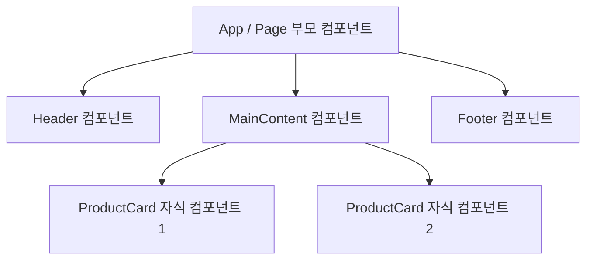

# 2026-10-08 React 컴포넌트 & Props & 이벤트 핸들링 학습 내용

## 1. 오늘 배운 내용과 목표

- 오늘 배운 주제: React 컴포넌트 기초, Props 전달 & 구조 분해 할당, 이벤트 핸들링, Next.js `'use client'` 경계
- 오늘의 목표: 컴포넌트 선언 및 재사용 원리 이해, Props 전달과 구조 분해 할당 활용, 이벤트 참조 vs 호출 차이 숙지, Next.js 클라이언트 컴포넌트 경계 설정
- 수업을 듣기 전 알고 있던 내용: React의 기본 개념을 전날 배웠으나 컴포넌트 간 데이터 전달과 동작 방식은 아직 낯선 상태

---

## 2. 개념과 용어 정리

### 1) 리액트 컴포넌트의 개념과 구조 (React Component)
- 컴포넌트(Component)란?
  - 화면의 UI 레고 블록: 화면의 특정 영역(버튼, 카드, 헤더, 모달 등)을 구성하는 독립적이고 재사용 가능한 자바스크립트 함수.
  - JSX 반환: 컴포넌트 함수는 화면에 그려질 HTML 형태의 코드(JSX)를 `return (...)` 구문으로 반환함.
  - 재사용성: 한 번 정의해 둔 컴포넌트는 필요한 곳마다 블록처럼 가져와 여러 번 반복 사용 가능.

- 컴포넌트 작성 3가지 규칙:
  1. 파스칼 케이스(PascalCase) 명명 규칙: 함수 이름의 첫 글자는 반드시 대문자로 시작해야 함 (소문자로 시작하면 일반 HTML 태그로 인식).
  2. JSX(UI 코드) 반환: 함수 내부에서 `return (...)` 구문을 사용해 화면에 표시할 마크업 코드를 반환.
  3. 내보내기(export) 방식 결정:
     - export default: 다른 파일에서 불러와 메인으로 사용할 대표 컴포넌트 (파일당 1개).
     - Named export (`export const ...`): 여러 컴포넌트를 한 파일에서 함께 내보낼 때 사용.
     - 파일 내부 전용: `export` 없이 파일 내부에서만 조각으로 쓰이는 하위 헬퍼 컴포넌트.

- 부모 컴포넌트와 자식 컴포넌트의 관계:
  - 부모 컴포넌트: 다른 컴포넌트를 자신의 JSX 코드 내부에 포함하여 렌더링하는 상위 컴포넌트.
  - 자식 컴포넌트: 부모 컴포넌트 내부에서 호출되어 렌더링되는 하위 컴포넌트.



---

### 2) Props 데이터 전달과 구조 분해 할당 (Props & Destructuring)

- Props(Properties)의 기본 개념 및 전달 방식:
  - 부모 컴포넌트가 자식 컴포넌트에게 HTML 속성(Attribute) 형태로 넘겨주는 읽기 전용 데이터 주문서.
  - 단방향 데이터 흐름 (Top-down): 데이터는 항상 `[부모 ➔ 자식]` 한쪽 방향으로만 전달됨.
  - 불변성 (Read-only): 자식 컴포넌트는 전달받은 Props를 직접 수정할 수 없음.

- 구조 분해 할당(Destructuring) 패턴:
  - 기존 점 표기법의 불편함: `props.title`, `props.price`, `props.isStock`처럼 매번 `props.`를 반복 작성해야 하므로 코드가 길어짐.
  - 구조 분해 할당 활용: 매개변수 위치에서 `{ title, price, isStock }` 형태로 객체를 바로 해체하여 꺼내 쓰므로 코드가 훨씬 간결하고 가독성이 높아짐.

- 특별한 Prop: `children` (태그 사이의 내용 전달):
  - 컴포넌트의 여는 태그와 닫는 태그 사이(`<Card>여기에 들어가는 내용</Card>`)에 포함된 모든 요소를 전달받는 리액트 예약 Props.
  - 일반 Props vs children Props:
    - 일반 Props (단일 속성): `<ProductCard price={49000} title="마우스" />` (속성값 위주 전달)
    - children Props (컨텐츠 래핑): `<Card><p>카드 내용</p><button>확인</button></Card>` (레이아웃을 감싸는 래퍼 컴포넌트 구현 시 활용)
  - 타입 지정 (TypeScript): `children`에는 문자열, HTML 태그, 다른 컴포넌트 등 무엇이든 올 수 있으므로 `React.ReactNode` 타입을 지정함.

---

### 3) 리액트 이벤트 핸들링 (React Events)

- 리액트 이벤트는 사용자의 동작(클릭, 입력, 제출 등)을 감지하여 실행할 함수의 이름(참조)을 전달하는 방식으로 동작.

- 함수 '호출' vs 함수 '참조'의 결정적 차이:
  - 올바른 방식 - 함수 참조 전달 (`onClick={handleClick}`)**:
    - 함수 이름 뒤에 괄호`()`를 붙이지 않고 함수의 참조값만 전달.
    - 사용자가 실제로 버튼을 클릭하는 시점에 리액트가 함수를 실행함.
  - 잘못된 방식 - 함수 즉시 호출 (`onClick={handleClick()}`)**:
    - 함수 이름 뒤에 괄호를 붙이면 컴포넌트가 렌더링되는 시점에 함수가 즉시 실행되어 버림.
    - 함수 내부에서 상태(State)를 변경할 경우 무한 리렌더링 렌더 루프 에러가 발생함.
  - 인자 전달이 필요한 경우 (화살표 함수 래핑):
    - 매개변수를 전달해야 할 때는 익명 화살표 함수로 감싸서 전달: `onClick={() => handleClick(id)}`

- Form 제출 이벤트와 기본 동작 방지 (`e.preventDefault()`):
  - 브라우저 기본 동작: HTML `<form>` 태그는 `submit` 발생 시 페이지 전체를 새로고침하며 서버로 데이터를 전송함.
  - e.preventDefault()의 역할: 리액트 SPA 앱에서는 전체 새로고침이 발생하면 메모리의 데이터 상태가 모두 초기화되므로, e.preventDefault()를 호출하여 브라우저의 기본 새로고침 동작을 중단시키고 순수 자바스크립트 로직으로 데이터를 처리함.

---

### 4) Next.js의 Server / Client 경계와 `'use client'`

- Next.js App Router의 컴포넌트 분류:
  - Server Component (기본값): Next.js App Router의 모든 컴포넌트는 기본적으로 서버에서 실행 및 사전 렌더링됨. 클라이언트 자바스크립트 번들에 포함되지 않아 성능이 매우 우수하지만, `onClick`, `onChange` 같은 브라우저 이벤트나 React Hook(`useState`, `useEffect`)을 사용할 수 없음.
  - Client Component 전환: 파일 최상단에 `'use client'` 지침(Directive)을 선언하면 해당 컴포넌트와 그 하위 컴포넌트들이 브라우저 상호작용을 처리할 수 있는 클라이언트 컴포넌트로 동작함.

- `'use client'` 선언 규칙과 권장 패턴:
  1. 파일 최상단 위치: 주석이나 임포트 문보다 먼저 파일의 가장 첫 번째 줄에 `'use client';`를 작성해야 함.
  2. 최소한의 영역 선언 (Leaf Component): 페이지 전체(`page.tsx`)에 `'use client'`를 선언하지 않고, 이벤트 처리가 필요한 최소 단위의 자식 컴포넌트(예: 버튼, 검색창)에만 선언하는 것이 성능과 번들 크기 최적화에 가장 유리함.

> [!NOTE]
> 💡 `'use client'` 지침과 SSR / CSR / 하이드레이션의 관계
> - SSR (Server-Side Rendering): 서버에서 초기 HTML 뼈대를 미리 생성하여 전송하므로 사용자가 빈 화면을 보지 않고 빠른 첫 로딩을 경험함.
> - CSR (Client-Side Rendering): 브라우저가 자바스크립트를 다운로드하여 실행하고 클릭, 입력 등의 인터랙션을 처리함.
> - `'use client'`의 동작 원리: `'use client'`를 붙였다고 해서 100% 클라이언트에서만 그려지는 것이 아닙니다. 초기 로딩 시 서버에서 HTML 뼈대를 사전 렌더링(SSR)한 뒤, 브라우저로 내려와 자바스크립트 이벤트 리스너를 결합하는 하이브리드 하이드레이션(Hydration) 방식으로 작동합니다.
> - 반면 지침이 없는 순수 서버 컴포넌트는 클라이언트로 JS 코드가 전송되지 않아 브라우저 번들 용량을 0 Byte로 유지할 수 있습니다.

---

### ⭐️ 필수 (실무 핵심 90%) - 반드시 기억
| 용어/문법 | 뜻 | 기억할 점 / 주의점 |
|---|---|---|
| `props` | 부모 컴포넌트가 자식에게 전달하는 읽기 전용 데이터 객체 | 단방향 데이터 흐름. 자식 컴포넌트에서는 수정 불가(Read-only) |
| `{ title, price }` | Props 구조 분해 할당 (Destructuring) | 매개변수에서 바로 해체하여 `props.` 반복 작성을 줄이고 가독성 향상 |
| `children` | 컴포넌트 태그 사이에 포함된 컨텐츠를 받는 특수 Prop | `<Card><p>내용</p></Card>` 형태. UI를 감싸는 레이아웃 래퍼에 필수 |
| `onClick={handleClick}` | 이벤트 핸들러 함수 참조 전달 | 함수 뒤에 괄호 `()`를 붙이면 즉시 실행되어 렌더링 에러 발생 |
| `e.preventDefault()` | 브라우저 기본 동작 차단 메서드 | `<form>` 제출 시 페이지 새로고침을 막아 SPA 상태 초기화 방지 |
| `'use client'` | 클라이언트 컴포넌트 선언 지침 | 파일 최상단(1행)에 작성. 브라우저 이벤트(`onClick`) 사용 시 필수 |

### 💡 참고 (검색용) - 이해만 하고 넘어가기
| 패턴/문법 | 뜻 | 필요할 때 찾는 팁 |
|---|---|---|
| `onClick={() => fn(id)}` | 인자가 있는 이벤트 핸들러 바인딩 | 파라미터 전달 시 익명 화살표 함수로 감싸서 즉시 실행 방지 |
| `React.ReactNode` | TypeScript에서 모든 렌더링 가능한 요소 타입 | JSX 요소, 문자열, 숫자, null 등을 모두 수용하므로 `children` 타입에 사용 |
| `Hydration (수화)` | 서버 HTML에 브라우저 JS 이벤트를 결합하는 과정 | `'use client'` 컴포넌트가 브라우저에서 동적으로 살아나는 핵심 원리 |
| `PascalCase` | 컴포넌트 함수 명명 규칙 | 컴포넌트 이름 첫 글자는 대문자여야 리액트가 커스텀 컴포넌트로 인식 |

---

## 3. 예제 및 실습

### 실습 내용
1. Props 구조 분해 할당과 `children`을 활용한 재사용 가능한 `Card` 컴포넌트 제작
2. 클릭 이벤트 핸들러 및 폼 제출(`e.preventDefault()`) 처리
3. Next.js App Router 호환을 위한 `'use client'` 지침 적용

```tsx
// ProductCard.tsx
'use client'; // 1. 브라우저 이벤트 처리를 위한 클라이언트 컴포넌트 선언

import React from 'react';

// 2. TypeScript Props 타입 정의
type ProductCardProps = {
  title: string;
  price: number;
  inStock?: boolean;
  children?: React.ReactNode; // 태그 사이 컨텐츠를 받기 위한 타입
};

// 3. 구조 분해 할당으로 Props 받기
export default function ProductCard({
  title,
  price,
  inStock = true,
  children,
}: ProductCardProps) {
  // 클릭 이벤트 핸들러 (참조로 전달)
  const handleBuyClick = () => {
    alert(`${title} 상품 구매가 완료되었습니다!`);
  };

  // 폼 제출 이벤트 핸들러 (기본 새로고침 방지)
  const handleReviewSubmit = (e: React.FormEvent<HTMLFormElement>) => {
    e.preventDefault(); // 페이지 새로고침 방지
    alert('리뷰가 등록되었습니다.');
  };

  return (
    <div className="card-box">
      <h3>{title}</h3>
      <p>가격: {price.toLocaleString()}원</p>
      <p>상태: {inStock ? '재고 있음' : '품절'}</p>

      {/* children Prop 렌더링 (외부에서 감싸서 넘긴 추가 UI) */}
      {children && <div className="card-desc">{children}</div>}

      {/* 이벤트 참조 전달: onClick={handleBuyClick} */}
      <button type="button" onClick={handleBuyClick}>
        구매하기
      </button>

      {/* Form 제출 이벤트 처리 */}
      <form onSubmit={handleReviewSubmit}>
        <input type="text" placeholder="한 줄 리뷰 입력" />
        <button type="submit">등록</button>
      </form>
    </div>
  );
}
```

### 실행 결과
- 정상적으로 된 부분: 
  - 컴포넌트 매개변수에서 구조 분해 할당을 적용하여 코드가 간결해짐.
  - `onClick={handleBuyClick}`으로 이벤트가 버튼 클릭 시에만 안정적으로 발동함.
  - `e.preventDefault()`로 폼 제출 시 전체 페이지 새로고침 없이 사용자 입력을 유지함.
- 새롭게 확인한 부분: 
  - `children` Props를 활용하면 컴포넌트의 레이아웃 틀은 그대로 두고 내부 컨텐츠를 자유롭게 갈아 끼울 수 있어 재사용성이 극대화됨.

---

## 4. 실수 및 트러블슈팅

### 발생한 문제 요약

#### 이슈 1: 이벤트 핸들러에 괄호 `()`를 붙여 무한 렌더링 / 즉시 실행 발생
- 상황: 버튼을 누르지도 않았는데 페이지가 열리자마자 `alert`나 상태 변경 함수가 실행되고 에러 발생.
- 원인: `onClick={handleClick()}`처럼 함수 호출문 형태로 작성하여 렌더링 시점에 즉시 실행됨.
- 해결:
```tsx
// ❌ 잘못된 코드: 렌더링 시점에 즉시 실행됨
<button onClick={handleClick()}>클릭</button>

// ✅ 올바른 코드: 함수의 이름(참조)만 전달하여 클릭 시 실행
<button onClick={handleClick}>클릭</button>

// ✅ 인자가 필요할 경우: 화살표 함수로 감싸서 전달
<button onClick={() => handleClick(productId)}>클릭</button>
```

---

#### 이슈 2: Server Component에서 브라우저 이벤트(`onClick`) 사용 시 빌드 에러
- 상황: Next.js App Router 컴포넌트에서 버튼 클릭 이벤트를 작성했더니 콘솔에 에러 발생 (`Event handlers cannot be passed to Client Component props...`).
- 원인: Next.js 컴포넌트는 기본이 서버 컴포넌트이므로 브라우저 전용 이벤트를 직접 사용할 수 없음.
- 해결: 파일 최상단 첫 번째 줄에 `'use client';` 지침 추가.
```tsx
// 파일 가장 첫 번째 줄에 선언
'use client';

import React from 'react';
// ...
```

---

#### 이슈 3: `<form>` 전송 시 전체 화면이 새로고침되며 상태 데이터 유실
- 상황: 등록 버튼을 클릭했을 때 페이지가 깜빡이면서 새로고침되고 리액트 앱 상태가 초기화됨.
- 원인: 브라우저 기본 `<form>` 전송 동작이 발동함.
- 해결: `e.preventDefault()`를 호출하여 브라우저의 기본 새로고침을 차단.
```tsx
const handleSubmit = (e: React.FormEvent) => {
  e.preventDefault(); // 기본 새로고침 방지
  // 리액트 데이터 처리 로직 수행
};
```

---

## 5. 오늘의 핵심

- ⭐️ 반드시 기억할 내용: 
  1. 컴포넌트는 PascalCase로 명명하며, JSX를 반환하는 독립적인 함수형 UI 블록이다.
  2. Props는 부모에서 자식으로만 흐르는 단방향 읽기 전용 데이터이며, 매개변수 구조 분해 할당(`{ prop1, prop2 }`)으로 깔끔하게 꺼내 쓴다.
  3. 이벤트 바인딩 시 반드시 함수 참조(`onClick={fn}`)를 넘겨야 하며, 괄호를 붙여 즉시 호출(`onClick={fn()}`)하면 안 된다.
  4. Next.js에서 클릭 등 사용자 이벤트 처리가 필요한 컴포넌트는 최상단에 `'use client';` 지침을 선언해야 한다.
- 💡 참고로 알아둘 내용: `children` Props는 TypeScript에서 `React.ReactNode` 타입으로 지정하며, 컴포넌트를 레이아웃 래퍼 형태로 확장할 때 핵심으로 쓰인다. `'use client'` 선언 파일도 서버에서 첫 HTML을 사전 렌더링(SSR)한 뒤 브라우저에서 하이드레이션(Hydration)되는 하이브리드 구조를 가진다.
- ⚠️ 헷갈리기 쉬운 주의점: 
  - 인자를 넘겨야 하는 이벤트 핸들러는 반드시 `onClick={() => handler(id)}` 형태로 화살표 함수로 래핑할 것.
  - `'use client'`는 페이지 전체에 남발하지 말고 이벤트/상태가 필요한 최소 단위의 자식 컴포넌트에 국소적으로 적용할 것.
- 한 문장 요약: React 컴포넌트의 단방향 Props 데이터 흐름과 올바른 이벤트 핸들링 규칙을 이해하고, Next.js의 클라이언트 컴포넌트 경계(`'use client'`) 분리 기준을 확립했다.

---

## 6. 느낀 점과 다음 학습

- 잘 이해한 부분:
  - 함수 호출(`fn()`)과 함수 참조(`fn`)의 차이점 및 왜 즉시 호출하면 무한 렌더링 문제가 생기는지에 대한 메커니즘.
  - 구조 분해 할당을 통해 `props.`를 일일이 붙이지 않고 간결하게 작성하는 패턴.
- 아직 어려운 부분:
  - 부모에서 자식으로 데이터를 전달하는 것을 넘어, 자식의 이벤트가 발생했을 때 부모의 상태를 역으로 업데이트하는 상태 끌어올리기(Lifting State Up)와 React State 훅(`useState`).
- 다음에 복습할 내용:
  - React State 관리의 기초인 `useState` 훅의 동작 원리와 불변성 유지 규칙.
  - 실무 스타일의 컴포넌트 분리 및 폴더 구조화 패턴.
- 오늘의 느낀 점:
  - 처음에는 React 컴포넌트가 단순히 HTML을 리턴하는 함수인 줄 알았는데, Props를 통한 데이터 전달과 이벤트 바인딩 규칙(참조 vs 호출) 속에 명확한 설계 원리가 담겨 있다는 것을 알게 되었다.
  - 특히 Next.js에서 서버 컴포넌트와 클라이언트 컴포넌트를 `'use client'` 경계로 나누어 최적화하는 구조를 배우면서 실무 풀스택 개발의 흐름이 한층 더 뚜렷해졌다. 사소한 괄호 하나, 지침 한 줄의 위치가 웹 앱의 성능과 동작을 결정짓는다는 것을 체감했다.
