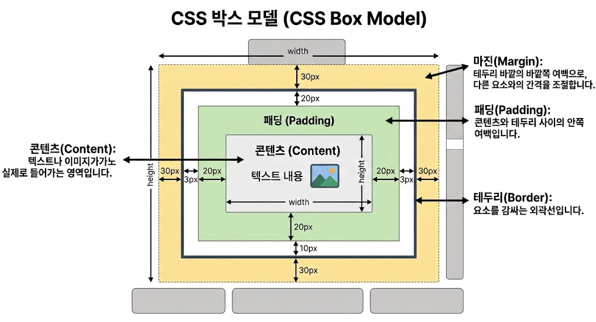
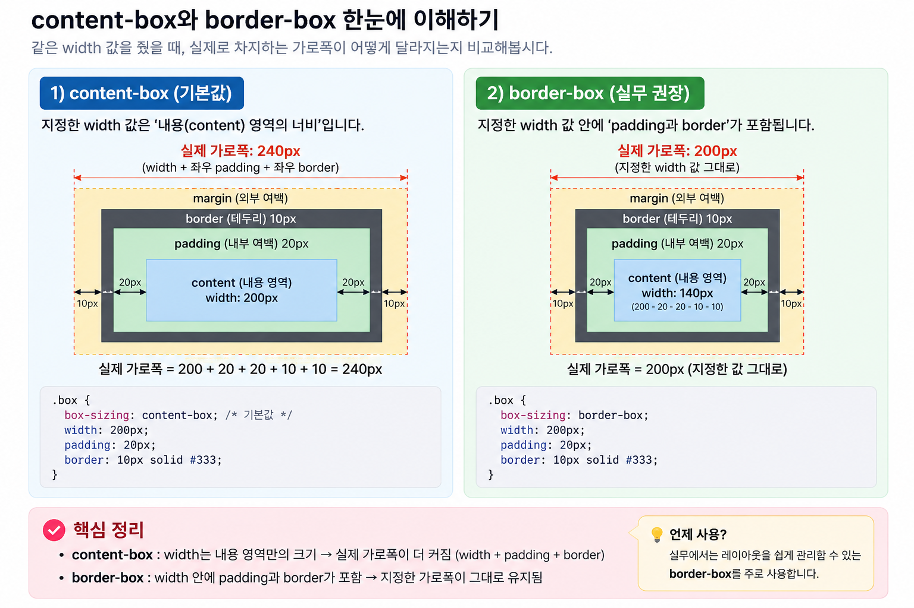

# 2026-09-26_html1 학습 내용

## 1. 오늘 배운 내용과 목표

- 오늘 배운 주제: CSS를 활용한 웹 스타일링 및 기본 레이아웃
- 오늘의 목표: CSS 기초와 스타일링, 박스 모델 및 위치 지정에대해 이해한다
- 수업을 듣기 전 알고 있던 내용: CSS가 HTML을 꾸미는 정도로 알고 있다

## 2. 개념과 용어 정리
```html
 - CSS 코드는 대상요소(선택자), 변경할 스타일성질(속성), 지정할 수치나 형식(값) 의 조합으로 선언
 - CSS 스타일 적용 기본 구조
   선택자 { 
     속성:값;
     속성:값;
     ...
   }
```
- 주석 및 예시
 ```html
  /* h1태그를 선택하여 글자 색상은 파랑, 글자크기는 20px 설정하는 예제 */
  h1 {
    color : blue; /* h1요소의 글자 파랑색 */
    font-size : 20px; /* h1요소의 글자크기 20px */
  }
  ```
 
 - 스타일 상속(Inheritance) : 부모 요소의 스타일을 자식 요소에게 자동 적용하는 것
 - 스타일 적용의 3가지 방식
  - 인라인 스타일(Inline style) : HTML 태그 내부의 style 속성에 직접 작성, 해당 요소에만 적용
  - 내부 스타일(Internal style) : `<head>` 안의 `<style>` 태그에 작성, 해당 HTML 문서에 적용
  - 외부 스타일(External style) : 별도의 `.css` 파일에 작성하고 `<link>`로 HTML과 연결, 여러 페이지에서 재사용 가능
- CSS 기본 선택자
  - `*` : 모든 요소 선택
  - `p` : 해당 태그 선택
  - `.class` : 해당 class 선택 ⭐
  - `#id` : 해당 id 선택 ⭐

- 관계 선택자
  - `.parent > p` : 바로 아래 자식 p만 선택 ⭐
  - `.parent p` : 내부의 모든 자손 p 선택 ⭐
  - `h1 + p` : 바로 다음 형제 하나
  - `h1 ~ p` : 뒤에 있는 형제들

### 가상 클래스(:) 와 가상요소(::)
  - 가상클래스(Pseude-class) : 콜론(:) 하나로 선택 // 요소의 특정 상태나 조건에 스타이을 부여 선택
  - 가상요소(Pseude-element) : 콜론 두개(::)로 선택 // 요소(텍스트나,디자인)를 CSS를 통해 종적으로 삽입
  - 가상 선택자(Pesudo Selector) : 콜론 한개(:) 또는 두개(::)로 선택 // 가상요소와 가상클래스를 통칭하여

### 스타일 적용 우선순위(Cascading & Specificity)
 - 순수 순서 규칙 (캐스케이딩 - Cascading) : 가중치가 완전히 동일한 규칙끼리 충돌할 떄는 가장 나중에 선언된 스타일이 이전 스타일을 덮어씀
 - 명시도 가중치(Specificity) : 선택자가 구체적이고 좁은 범위를 타케팅 할 수록 점수가 높게 산정되어 최우선 적용 됨
 - 인라인 스타일 최우선 원칙 : 외부파일이나 내부 스타일 태그보다 직접 삽입된 `style=""`속성이 우선권을 가짐
 인라인 1000점 >  id 선택자 100점 > 클래스/가상클래스 10점 > 태그/가상요소 1점 > 상속/전체선택자 0점 으로 보면됨

### ⭐️ 필수 (실무 핵심 90%) - 반드시 기억

#### 1. CSS 기본 용어
| 용어/명령어 | 뜻 | 기억할 점 / 주의점 |
|---|---|---|
| `CSS` | 스타일을 지정하기 위한 언어 | HTML이 '구조'라면 CSS는 '디자인(스타일)' |
| `선택자(Selector)` | 스타일을 적용할 대상을 지목 | h1, p, .class, #id 등 |
| `속성(Property)` | 변경할 스타일의 종류 | color, font-size 등 |
| `값(Value)` | 속성에 적용할 구체적인 수치 | blue, 20px 등 |

#### 2. 선택자 (Selector)
| 종류 | 문법 | 뜻 | 적용 시점 / 주의점 |
|---|---|---|---|
| 태그 선택자 | `p { }` | 특정 태그 전체 | 여러 태그에 공통 스타일 적용 시 |
| 클래스 선택자 | `.box { }` | 특정 클래스 | 여러 태그에 같은 스타일 적용할 때 유용 (가장 자주 사용) |
| 아이디 선택자 | `#header { }` | 특정 아이디 | 해당 요소에만 고유하게 적용 |
| 자식 선택자 | `.parent > p` | 바로 아래 자식 | 부모-자식 관계일 때만 적용 |
| 자손 선택자 | `.parent p` | 내부의 모든 자손 | 부모 안의 모든 자식/자손에게 적용 |

#### 3. 가상 클래스(:) & 가상 요소(::)
| 문법 | 상태 / 위치 | 자주 사용하는 곳 |
|---|---|---|
| `:hover` | 마우스를 올린 상태 | 버튼, 링크 등의 마우스 반응 |
| `:focus` | 포커스를 받은 상태 | input 클릭/Tab 선택 시 |
| `:checked` | 체크된 상태 | checkbox, radio 버튼 |
| `:disabled` | 비활성화 상태 | 사용할 수 없는 입력 요소 |
| `:first-child` | 첫 번째 자식 | 형제 중 첫 번째 요소 선택 |
| `:last-child` | 마지막 자식 | 형제 중 마지막 요소 선택 |
| `:nth-child(n)`| n번째 자식 | 특정 순서의 요소 선택 |
| `::before` | 요소 내용의 맨 앞 가상 요소 추가 | `content` 속성과 함께 사용 |
| `::after` | 요소 내용의 맨 뒤 가상 요소 추가 | `content` 속성과 함께 사용 |

#### 4. 주요 스타일 속성 (텍스트 & 폰트)
| 속성 | 뜻 | 자주 쓰는 값 / 특징 |
|---|---|---|
| `font-family` | 글꼴 지정 | 폰트 이름 (순서대로 적용됨) |
| `font-size` | 글자 크기 | `px`, `rem`, `em` 등 |
| `font-weight` | 글자 굵기 | `normal`, `bold`, `100~900` |
| `font-style` | 글자 스타일 | `normal`, `italic` |
| `line-height` | 줄 높이 | 줄 간격 조절. (단위 없는 값 사용 권장) |
| `text-align` | 텍스트 정렬 | `left`, `center`, `right` |
| `color` | 글자 색상 | HEX, RGB(A), 색상 이름 |

#### 5. 주요 스타일 속성 (배경)
| 속성 | 뜻 | 자주 쓰는 값 / 특징 |
|---|---|---|
| `background-color`| 배경색 | HEX, RGB(A), `transparent` |
| `background-image`| 배경 이미지 | `url('이미지경로')` |
| `background-position`| 배경 위치 | `center`, `top`, `right` 등 |
| `background-size` | 배경 크기 | `cover`, `contain` ⭐ |
| `background-repeat`| 배경 반복 | `no-repeat` (자주 사용) |

- `font-family`는 앞의 폰트가 없으면 뒤의 폰트를 순서대로 사용
- `rem` : 최상위 `<html>`의 글자 크기를 기준으로 계산
- `em` : 해당 요소의 계산된 글자 크기를 기준으로 계산
- 웹 폰트 : 사용자 PC에 폰트가 없어도 외부/서버에서 불러와 사용 가능

### 실습 내용

```html
실습에 사용한 명령어나 코드
<a href="./practice_html/2026_09_26_html1.html" target="_self">두번째 실습 바로가기</a>
로 테스트완료
```
### 실행 결과
- 정상적으로 된 부분: 거의 설명위주고 실행은 나중에 실습 과제로 해야될거 같아요
- 새롭게 확인한 부분: css 파일의 유용도정도 나눠서 관리하니 보수관리가 좋다

# 2장 1강을 진행했다. - 이어서 2장 2강을 해야되므로 이어서 진행하도록 하려고한다.

 - 2장 박스 모델 및 위치 지정

## 2. 개념과 용어 정리
 - CSS 박스 모델의 이해 : 박스모델을 구성하는 4대요소
  - 콘텐츠(Content) : 박스의 실제 내용이 표시되는 영역 
  - 패딩(Padding) : 콘텐츠 영역을 감싸는 내부 여백 
  - 보더(Border) : 콘텐츠 영역을 감싸는 테두리
  - 마진(Margin) : 박스 외부의 외부 여백


### 박스 크기 계산의 기준 : box-sizing
 - content-box(기본값) : 너비(width)와 높이(height)를 콘텐츠 영역에만 적용
 - border-box(권장) : 너비(width)와 높이(height)에 테두리를 포함한 박스 전체크기, 패딩과 테두리가 추가되어도 설정한 크기가 유지되므로 크기 계산이 매우 직관적
 

### display속성을 홀용한 요소 유형 변경
 - HTML 요소의 두가지 고유성질 : Block 과 Inline
 - block 의 성질
  - 배치규칙 : 언제나 새로운 줄(New line)에서 시작, 부모요소의 가로 너비를 100% 채움
  - 크기 및 여백 : 너비, 높이, 상하좌우 마진과 패딩 을 모두 자유롭게 조절할 수있음
  - 대표 태그 : `<div>`, `<p>`, `<h1>~<h6>`, `<ul>`, `<ol>`, `<li>` 등
 - inline 의 성질
  - 배치규칙 : 줄바꿈없이 다른 요소들과 나란히 한줄로 배치, 딱 콘텐츠의 크기만큼만 영역을 차지
  - 크기제어 : 너비 높이를 지정할수 없음
  - 여백제한 : 좌우마진/패딩은 정상 작동하지만, "상하 마진(top/bottom)은 완전무시당함, 상하 패딩은 시각적으로 늘어나 보이지만, 주변 요소의 위치를 밀어내지못하고 겹치게 됨
  - 대표 태그 : `<a>`, `<span>`, ``, `<strong>`, `<em>` 등
 

 ## 요소의 기본 성질을 변경하는 display 속성
  - `display: block` : 인라인 요소를 블록처럼 바꿉니다
  - `display: inline` : 블록 요소를 인라인처럼 바꿉니다
  - `display: inline-block` : 기본배치는 인라인처럼 나란히 서되, 블록처럼 너비/높이 및 상하 마진을 자유롭게 가질 수 잇도록 결합한 하이브리드 속성
  - `display: none` : 요소를 완전히 감추고, 차지하던 공간마저 지워버림
   
  - `display:none` vs `visibility:hidden` : 둘다 화면에서 사라지게 하는 기능이지만, display:none은 요소를 완전히 지워버리지만, visibility:hidden은 요소를 감추지만 차지하던 공간은 그대로 남긴다.

## position 속성을 활용한 공간배치
 - 위치 지정의 기준값
  - static(기본갑) : HTML문서의 흐름에 따라 순서대로 배치, 위치이동값을 주어도 무시
  - relative(상대배치) : 자신이 원래있어야 할 위치를 기준으로 상대적 이동, 주변 요소의 흐름을 깨뜨리지않으며 미세한 조정을 할 때 주로 사용하게됨 absolute의 기준점
  - absolute(절대배치) : 일반적인 흐름에서 완전히 벗어남, static이 아닌 가장 가까운 조상(부모)요소를 기준으로 절대적인 좌표값을 찾아 이동, 만약기준이 되는 부모가 없다면 브라우저 전체화면을 기준으로 삼음
  - fixed(고정배치) : 부모 요소와 상관없이 오직 브라우저 창(Viewport)를 기준으로 고정됨. 페이지를 아래로 길게 스크롤해도 화면상의 그 자리에 늘 머물러 있슴.
  
### ⭐️ 필수 (실무 핵심 90%) - 반드시 기억
| 용어/명령어 | 뜻 | 기억할 점 / 주의점 |
|---|---|---|
| `명령어1` |  |  |
| `명령어2` |  |  |

### 💡 참고 (검색용) - 이해만 하고 넘어가기
| 패턴/문법 | 뜻 | 필요할 때 찾는 팁 |
|---|---|---|
| `옵션1` |  |  |

## 3. 예제 및 실습

### 실습 내용

무엇을 만들거나 연습했는지 적는다.

```bash
실습에 사용한 명령어나 코드
```

### 실행 결과
- 정상적으로 된 부분: 
- 새롭게 확인한 부분: 

## 4. 실수 및 트러블슈팅

### 발생한 문제 요약
- **상황**: 어떤 작업을 하다가 무엇이 안 됐는지
- **원인**: 왜 문제가 발생했는지
- **해결**:
```bash
해결한 명령어나 코드
```
- **해결 결과**:
  - 정상적으로 해결되었는가?
  - 다음에는 무엇을 확인해야 하는가?

## 5. 오늘의 핵심
- ⭐️ 반드시 기억할 내용: 
- 💡 참고로 알아둘 내용: 
- ⚠️ 헷갈리기 쉬운 주의점: 
- 한 문장 요약: 

## 6. 느낀 점과 다음 학습
- 잘 이해한 부분: 
- 아직 어려운 부분: 
- 다음에 복습할 내용: 
- 오늘의 느낀 점: 
